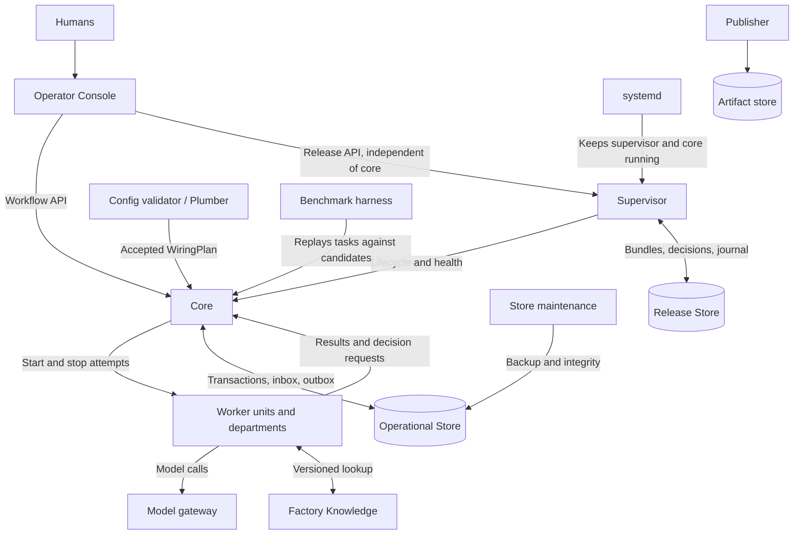
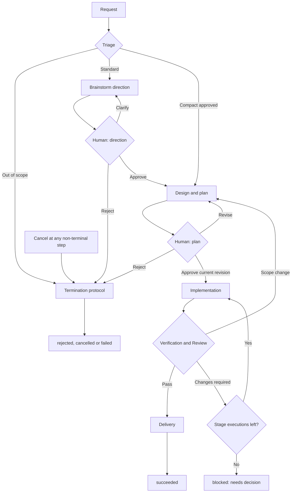
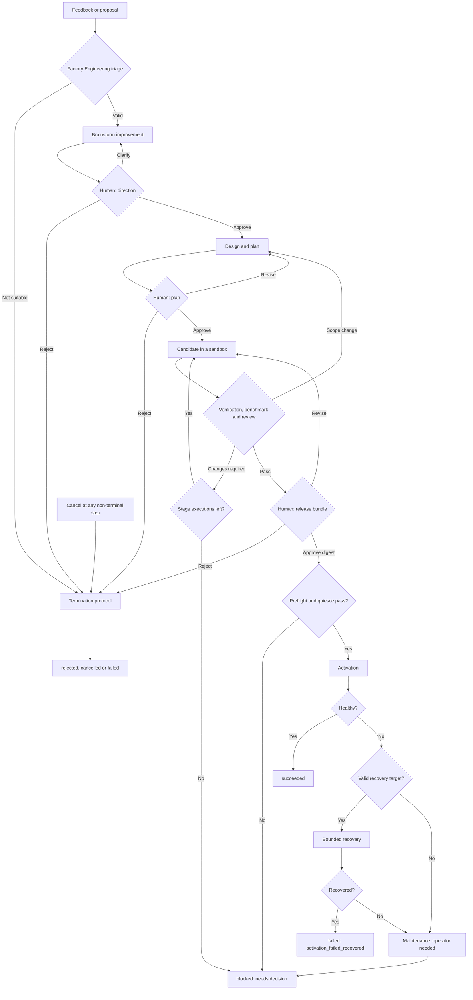

# LiveFactory Target Architecture

- Version: 0.3
- Status: Informative. It describes where the factory is heading after Ring 0. It is not
  implemented and is not a commitment for any ring until that ring's specification adopts it.
- Date: 2026-10-19
- Normative for Ring 0: [`docs/spec/r0-core.md`](../spec/r0-core.md)
- Decisions: [`docs/adr/`](../adr/)

## 1. Goal

LiveFactory is a software factory that turns user requests into verified changes and can
**improve itself**. It improves department prompts, skills and tools, its workflow
definitions, and its own core code. It never changes its human gates
([ADR-0005](../adr/0005-self-improvement-scope.md)).

"Always correct and always running" is interpreted as checkable invariants, fault
isolation, detection and recovery. There is no promise of zero crashes, zero data loss
or exactly-once external effects.

## 2. Principles

- **Humans own** direction, plans, risk profiles and every update to active factory
  behaviour or configuration.
- **Core is deterministic.** It applies transitions and structural guards and never calls
  a model ([ADR-0006](../adr/0006-deterministic-core.md)). Intelligence lives in
  departments. When a route needs judgement, a department returns a value from a declared
  enum and core checks it with a guard.
- **Operational contract vs. work contract.** Core and the config validator check where a
  message came from, identity, state, revision, delivery and transitions. Humans and
  departments own goals, scope, acceptance criteria and quality.
- **No cost budget in core; finite execution limits everywhere.** Token and cost use is
  observed.
- **Identity and isolation are mandatory** from the first worker that runs arbitrary code.
- **Grow by rings.** A ring adds a complete, visible capability. Each ring starts only
  after the previous one has passed its acceptance scenarios.

## 3. Components

| Component | Owns | Does not own |
|---|---|---|
| Humans | Direction, plans, risk profiles, factory updates, finite exceptions | Each tool call inside delegated scope |
| Operator Console | Showing decision packets; sending commands under the human's identity | Approving by itself or editing state |
| Core | State machine, dispatch, receipts, guards, stop control | Understanding requests, designing, coding, judging quality |
| Config validator / Plumber | Descriptor and schema compatibility, routes, gate floor | Business approval or silently replacing active wiring |
| Departments | Triage, brainstorming, design, planning, implementation, verification, review, delivery | Writing core state, issuing identity, updating the factory |
| Factory Engineering | Improvement backlog and proposals | Approving its own candidates |
| Verification runner | Trusted checks, isolated candidate environments, measured evidence | Changing acceptance criteria during the evaluation it runs |
| Benchmark harness | Replaying tasks to show a candidate is better, not only not worse | Being changed by the candidate it measures |
| Supervisor | Core lifecycle, activation and recovery for approved releases | Reviewing source, calling models, coordinating work |
| Store maintenance | Snapshots, integrity checks, restore drills | Restoring an old backup and replaying the outbox by itself |
| Factory Knowledge | Index and wiki with source revisions | Authority over permissions, live health or active versions |

Verification and Review are independent from Implementation in assignment, evidence
namespace and context. Two calls to the same model are not two independent sources of
evidence. Deterministic checks carry the most weight.

## 4. Rings

| Ring | Capability | Adds | Explicitly deferred |
|---|---|---|---|
| 0 | One local request → one human gate → a verified candidate | Core, SQLite, CLI, three department roles, worker units, model gateway, publisher, artifact store, static config validation, manual backup and rollback | Everything below |
| 1 | Replace or add a real provider without touching core lifecycle; improve department prompts, skills and tools; then workflow definitions | Conformance suite, descriptor versioning, provider pinning, benchmark harness, gate-floor check, Standard profile with two gates | Hot swap of running jobs, HA, a generic plugin platform |
| 2 | Improve core code: proposal → isolated candidate → human release → activation and recovery with evidence | Factory Engineering workflow, Verification runner, Supervisor, Release Store, independent Console admin path | Automatic approval, self-modification of supervisor or identity, breaking schema migrations |
| 3 | Scale where measurements show a bottleneck | Queues, storage, knowledge or infrastructure chosen from data; leases when execution leaves the host | A distributed design before the data asks for it |

Department improvements come before core improvements because they are cheaper, more
frequent and roll back by switching a pinned version at a job boundary. They do not need
a supervisor.

## 5. Human gates by risk

| Profile | When | Required gates |
|---|---|---|
| Compact | Small task, clear scope, one repository, no change to shared contracts, permissions, storage or architecture | One packet covering profile, direction and plan |
| Standard | Solution choice, dependencies or scope need discussion | Direction, then plan |
| Factory update | Any change to active core, supervisor, policy, wiring or provider version | Compact or Standard for preparation, plus a release decision for the final candidate |
| Escalated | Touches identity, migration, recovery, critical invariants, or exceeds the plan | Specialist review and an explicit impact and recovery brief; never Compact |

Departments propose a profile; the operator's configuration decides eligibility, and the
approval covers the profile. Track queue age, waiting time, packets returned for missing
evidence, rework after approval and escaped defects. Reading time is a weak signal and
never grants anything.

When the decision queue grows, reduce intake. Never remove a gate to raise throughput.

## 6. Workflow A — user requests (Standard profile)

When Delivery gains publish or deploy actions, each one needs its own scope, permission
and idempotency key, and its effects must be accounted for before the workflow ends.
The key (`effect_key`) must stay the same across attempts that retry **the same action**;
a per-attempt key does not stop a duplicate effect across two attempts. It helps only when
the backend deduplicates on it and binds it to the operation's content; otherwise query
the outcome or stop for the operator.

## 7. Workflow B — improving the factory

- Factory Engineering owns proposals and the backlog, not runtime rights. Implementation
  builds the candidate, Verification and the benchmark produce evidence, Review judges,
  and a human decides.
- A release decision binds to an immutable bundle digest. Changing the candidate, the
  manifest or the activation plan voids it for the new bundle.
- Release authority and the release gate (HU) follow
  [ADR-0004](../adr/0004-release-authority.md).
- Before core upgrades itself, the job that built the candidate has ended. Waiting for
  activation is `blocked(reason=external_release_pending)` and keeps no worker alive.
  Quiesce does not wait for this workflow, which avoids a self-upgrade deadlock.
- A successful recovery means the runtime is usable again. The improvement workflow still
  ends `failed` with `activation_failed_recovered`.
- Cancelling during activation never kills the supervisor. The workflow waits for the
  real outcome; `cancelled` does not mean the release never applied.

## 8. Candidates, evidence and the supervisor

### 8.1. Where a core candidate runs

A candidate core runs in an isolated instance on a **consistent copy** of the
Operational Store, never on the live store.

1. Store maintenance makes a snapshot with schema version, cursor and artifact refs,
   without production credentials.
2. The operator-managed Verification runner starts the candidate in a sandbox with test
   doubles for every external effect.
3. The candidate loads state written by the active core in every job state and performs
   sample transitions with correct guards.
4. The runner checks deduplication, decision revisions, crashes at commit and
   acknowledgement boundaries, stale results, store failure and stop and recovery. The
   baseline's checkers run on the candidate; the candidate cannot replace them.
5. For rollback, the **old binary must process state written by the candidate**. "New
   reads old" proves only the forward direction.
6. Replays never re-send production actions.

Compatibility is a tested range, not a promise for every possible state. Untested
fixtures, schemas and workflows are listed in the evidence.

### 8.2. Who produces and who trusts the manifest

Implementation may propose compatibility claims; they are untrusted input. The
Verification runner produces the **VerificationManifest** from what it measured:
candidate and baseline digests, supported schema and workflow versions, forward and
rollback compatibility results, recovery drill results, checker and runner identity, and
every failed or skipped check. Only trusted writers can write its namespace.

The supervisor checks identity, digests, verdicts, versions and structured
preconditions. It never trusts a `compatible=true` claim from a candidate.

### 8.3. Who activates each kind of change

| Target | Applied by | Boundary |
|---|---|---|
| Department prompt, skill, tool or provider | Core, switching the pinned `provider_version` for new jobs after a release decision | Running jobs keep their version |
| Workflow definition | Core, loading the accepted definition | Running instances keep their definition; migrating an instance is a separate change |
| Core executable | Supervisor | Stop dispatch, drain, stop core, swap target, start, check health |
| Supervisor, identity, unit files, polkit rules, root recovery logic | Operator through systemd maintenance | Never self-applied; part of the protected set |
| Schema migration | Separate maintenance path with backup and restore evidence and a human decision | Breaking migrations are not automated |
| Knowledge index | Indexer by source revision | Derived data only; turning it into active instructions needs an update gate |

### 8.4. Activation and recovery

The Release Store keeps immutable bundles, decisions, evidence, active and previous
pointers and an activation journal. It is not a table in the Operational Store that the
upgrading core owns. If the journal cannot be read or written, the supervisor starts no
activation or recovery and stays in maintenance.

The supervisor is a small deterministic state machine: `ready → activating → observing →
ready`, or `recovering → ready | maintenance`. Every operation has an ID, a journal entry
and a deadline. After a restart it reads the journal and checks the real target before
continuing.

1. **Preflight**: decision, manifest, digests, core and store health, current versions.
   State outside the verified range blocks and asks for re-verification.
2. **Quiesce**: stop dispatch and stop workers within a deadline. Unknown effects block
   activation. Confirm the pre-update snapshot is readable.
3. **Activate**: journal the intent, swap the target atomically, start the candidate.
   Never run two core writers on one store.
4. **Observe**: boot, readiness, one safe read and write cycle, and health of the dispatch
   loop. No production side effects during the first observation window.
5. **Success**: record the active target and a durable receipt.
6. **Failure**: bounded recovery to a valid target, or maintenance and the operator.

Recovery inside the target and range the human approved needs no new approval during an
incident. Anything else goes to the operator. Rolling back code does not restore data.

The supervisor needs no second supervisor: systemd restarts it with rate limits. Host
power loss or storage failure still needs the operator.

## 9. Self-improvement

Decision: [ADR-0005](../adr/0005-self-improvement-scope.md).

The factory may improve three layers: (a) department prompts, skills and tools,
(b) workflow definitions, (c) core code. It may not change its human gates, directly or
indirectly.

Indirect paths that must be closed:

- A workflow candidate that drops a gate or routes around it. The gate-floor check
  rejects any candidate whose gates do not cover the protected baseline gates, and any
  route to Implementation, Delivery or release that bypasses them.
- A core candidate that weakens the guards. The baseline gate tests run on every core
  candidate, and the candidate cannot change them.
- A department that learns to make approval easier: proposing Compact more often or
  writing more persuasive packets. Profile eligibility is operator configuration, the
  packet format is protected, and rework-after-approval and escaped defects are tracked
  per department version. The benchmark never rewards fast human approval.

**Benchmark.** "Not worse" is regression testing; "better" needs a benchmark. The harness
combines a small fixed task set, which is a floor the candidate must not fall below, and
real past tasks sampled on rotation and hidden from departments. It compares success
rate, rework rounds, blocks, tokens and time between the baseline and the candidate.

**Protected set.** Changed only by the operator through maintenance, never by Workflow B:
the gate floor, identity, the admin path and the supervisor, unit files and polkit rules,
baseline checkers, the benchmark harness and its task sets, and the minimum decision
packet format.

## 10. Configuration validation and Plumber

R0 validates a static configuration file. Later rings add descriptor discovery, a
conformance suite and impact checks. Minimum checks:

- Stage, provider and schema references exist and versions are pinned.
- Every allowed outcome has a route or a terminal or error handler.
- Required decisions precede the stages that need them; no route bypasses the
  Implementation or release guards; the gate floor holds.
- Every automatic cycle passes a finite limit; rejection, cancellation and out-of-scope
  have exits.
- Provider permissions and effect classes fit the configured scope; no privilege increase.
- Input and output mappings are validated with fixtures. Matching schemas do not prove
  matching meaning.

When a second real provider exists, build the shared conformance suite before extending
an SDK. Do not build a policy DSL, service bus or plugin marketplace in advance.

## 11. Observability and knowledge

| Question | Authoritative source |
|---|---|
| Which version is running? | Supervisor release status; R0: operator metadata |
| Where is a workflow, and who is it waiting for? | Core state and decision queue; "unavailable" when core is down |
| Why is it blocked or cancelling? | Reason, unresolved effects and `next_action` |
| What is each department doing? | Attempt, provider version, deadline |
| What evidence backed the last update? | Immutable bundle, manifest and human decision |
| Is the backup usable? | Maintenance status and the last restore drill |
| How is the system organized? | Component catalog and knowledge with source revisions |

Observability and knowledge never block core. If the exporter or the wiki is down, core
keeps running and dashboards show stale or unavailable data.

[OpenWiki](https://github.com/langchain-ai/openwiki) is a candidate for the knowledge
layer, not a dependency. Each page or chunk carries a source commit or artifact digest
and an index time. Measure it with questions about architecture and ownership: answer
correctness against source, staleness, time to find the right component and context
tokens used. Knowledge never overrides decision records, active wiring or release status.

## 12. Open decisions

- Implementation stack ([ADR-0007](../adr/0007-implementation-stack.md), proposed) and the
  supervisor's language, decided in Ring 2.
- First and second worker providers ([ADR-0008](../adr/0008-first-worker-provider.md),
  proposed).
- Platform adapters for activation, publish and deploy, and provider-specific idempotency.
- When to add automatic knowledge indexing, storage replication or multiple core workers.

Changing an accepted contract (identity, admin independence, the state machine, delivery
semantics, unknown outcomes, human release authorization) requires a new ADR and new
acceptance evidence.

## 13. References

Direction:

- [Inside a Software Factory — O'Reilly](https://www.oreilly.com/radar/inside-a-software-factory/)
- [Software Factories — Addy Osmani](https://addyosmani.com/blog/software-factories/)
- [OpenWiki — LangChain](https://github.com/langchain-ai/openwiki)

Technical limits:

- [SQLite transactions](https://www.sqlite.org/lang_transaction.html),
  [atomic commit](https://www.sqlite.org/atomiccommit.html),
  [online backup](https://www.sqlite.org/backup.html),
  [PRAGMA](https://www.sqlite.org/pragma.html)
- [systemd.service](https://www.freedesktop.org/software/systemd/man/latest/systemd.service.html),
  [systemd.exec](https://www.freedesktop.org/software/systemd/man/latest/systemd.exec.html),
  [systemd.unit](https://www.freedesktop.org/software/systemd/man/latest/systemd.unit.html),
  [systemd-run](https://www.freedesktop.org/software/systemd/man/latest/systemd-run.html)
