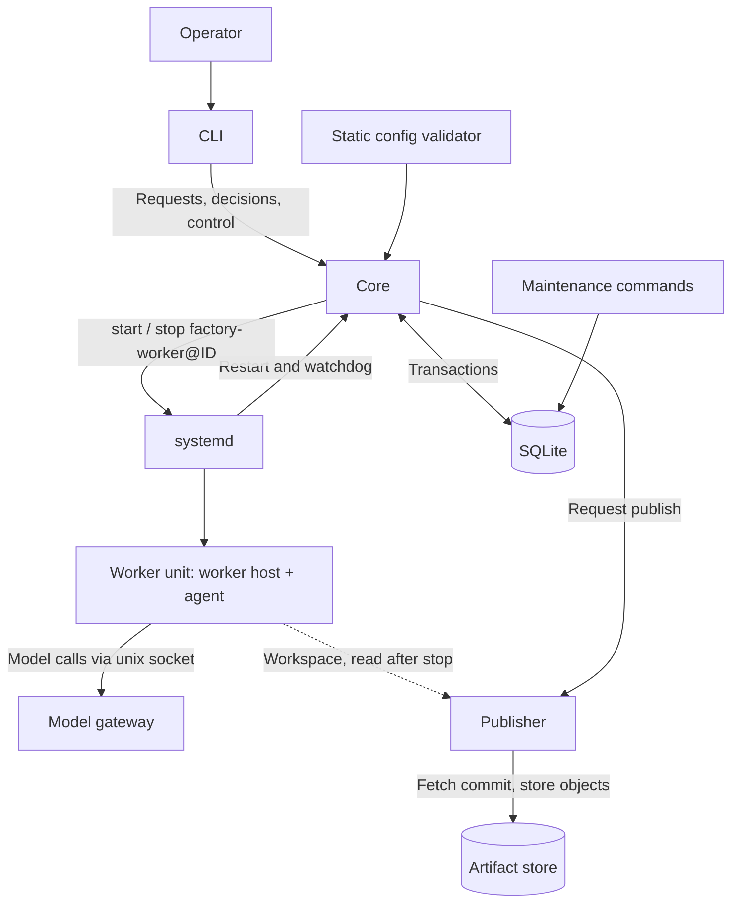
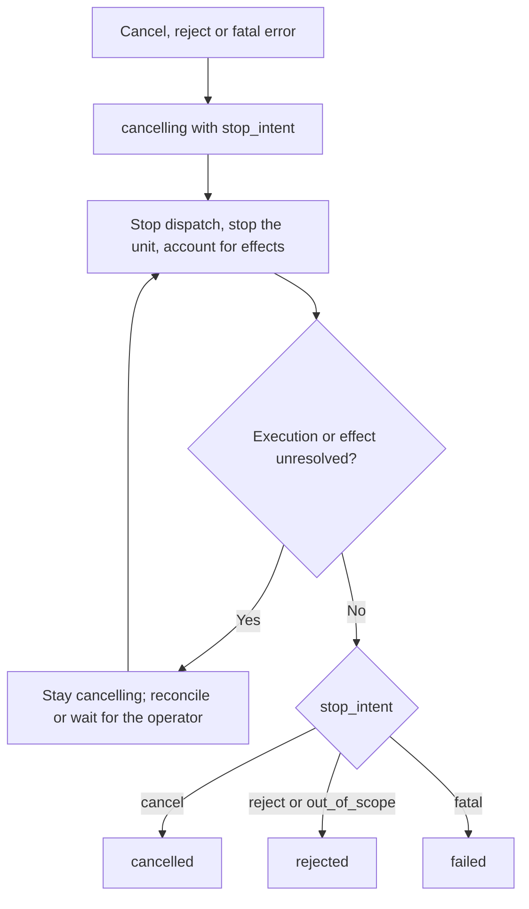
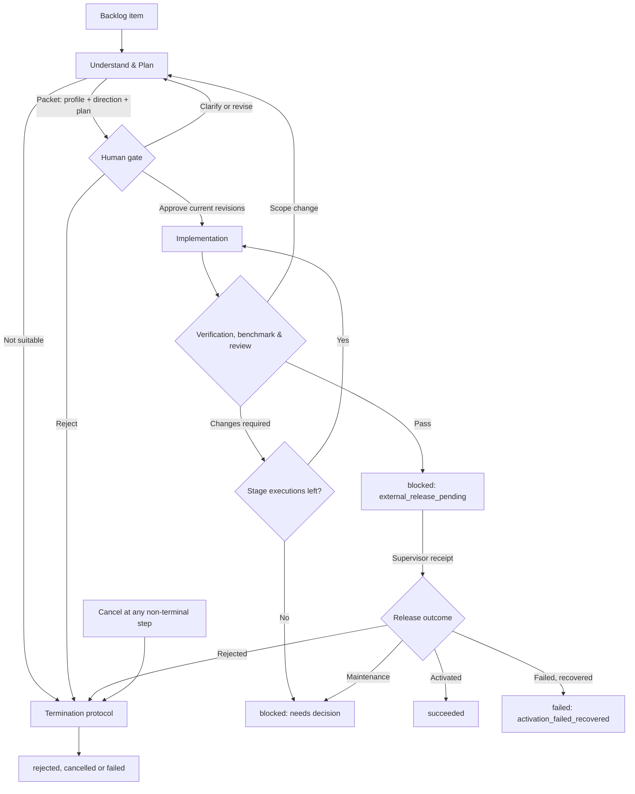

# Ring 0 Core Specification

- Version: 0.3
- Status: Accepted design; not implemented; no acceptance scenario has run
- Date: 2026-10-19
- Scope: the contract Ring 0 (R0) must implement and pass before Ring 1 starts
- Companion documents: [target architecture](../architecture/target.md) (informative) and
  the [ADRs](../adr/) (decisions with trade-offs)

This document is **normative**. "Must" and "must not" are requirements; "should" is a
default that may change with recorded evidence. Numbers marked *default* are starting
values to measure, not benchmarks or commitments. Anything not described here is out of
scope for R0, even if the target architecture describes it.

Version 0.3 replaces the Vietnamese design draft v0.2. It keeps that draft's state
machine, invariants and termination protocol, and applies the review decisions:
separate retry and handoff counters, local execution without leases, deterministic
reconciliation, a model credential gateway, profile-covering approvals and workspace
publishing.

## 1. Profile and minimum value

R0 is **self-hosting** ([ADR-0009](../adr/0009-self-hosting-first-ring.md)). It
delivers one feature end to end: **an improvement from the backlog → one human approval
→ a verified candidate of LiveFactory itself → a human release decision → activation by
the supervisor, with recovery if it fails**.

The R0 profile is fixed:

- Linux with systemd as the service manager; one host; the repository under work is
  LiveFactory itself.
- One core process, which is the only writer of the Operational Store (SQLite).
- At most one worker attempt executing at a time.
- One workflow definition: the Compact improvement workflow (section 9).
- Worker effects are limited to the attempt's own workspace and calls through the model
  gateway. The only other effect is activation, performed by the supervisor after a human
  release decision. No push, publish or deploy.

Explicitly deferred: the user-request workflow (Ring 1), leases and heartbeats, multiple
workers, a web console, dynamic plugins, automatic knowledge indexing, artifact garbage
collection, breaking schema migrations and high availability.

**Bootstrap.** Until the loop above works, humans with Claude Code build the factory
outside the factory.

## 2. Terms

| Term | Meaning |
|---|---|
| Workflow instance | One run of a workflow definition for one request |
| Stage | A named step of the definition, such as Plan, Implement or Verify |
| Job | One logical invocation of a stage. Rework creates a new job occurrence of the same stage |
| Attempt | One execution of a job. Its ID (a ULID) also names its worker unit |
| Handoff | A worker stops and asks a human for input; the job waits without a live attempt |
| Gate | A stage closed by a human decision instead of a worker |
| Workspace | The attempt's private, disposable working copy |
| Artifact | Immutable content identified by digest: a git commit or a sha256 object |
| Publish | Turning workspace output into artifacts before core commits references to them |

## 3. Components



| Component | Owns | Must not |
|---|---|---|
| CLI | Submitting requests and decisions under the caller's authenticated identity | Approve on its own or edit state directly |
| Core | State machine, dispatch, counters, receipts, guards, stop control | Call a model, interpret content, or judge quality ([ADR-0006](../adr/0006-deterministic-core.md)) |
| Static config validator | Checking the workflow and department config before core loads it | Change active config without an operator record |
| Worker host | Running the agent inside the unit, writing `result.json`, forwarding model calls to the gateway | Choose the next stage or hold credentials |
| Model gateway | The provider credential, the model allowlist and usage records ([ADR-0002](../adr/0002-model-credential-gateway.md)) | Run inside a worker unit |
| Publisher | Moving output into the artifact store after the worker stops ([ADR-0003](../adr/0003-workspace-output-publishing.md)) | Execute anything from the workspace |
| Artifact store | `candidates.git` for code and a sha256 object store for everything else | Overwrite or delete an object in R0 |
| Maintenance commands | Backup, restore, integrity checks, manual rollback | Replay the outbox after a restore |
| Supervisor | Activation, observation, a watch window and recovery of an approved release (section 12a) | Review source, call a model, coordinate work |
| Release Store | A directory of immutable bundles plus an activation journal | Live inside the Operational Store |
| Benchmark harness | Replaying the fixed task set against baseline and candidate | Be changed by the candidate it measures |

The supervisor, Release Store, benchmark harness and its task set belong to the protected
set. The CLI talks to the supervisor through its own socket, never through core.

### 3.1. Departments in R0

1. **Understand & Plan**: acts as Factory Engineering. Reads the improvement backlog,
   clarifies, proposes direction and plan; returns one decision packet.
2. **Implementation**: executes the approved plan in its workspace and commits there.
3. **Verification & Review**: runs trusted deterministic checks (tests, lint, type checks)
   and an LLM review as a secondary signal. Its assignment and evidence namespace are
   separate from Implementation's.

There is no Delivery department in R0; delivery is activation (section 12a).

## 4. Records

Minimum fields. IDs are unique within the factory. Human and worker identity comes from
the authenticated channel, never from a field the caller supplies.

| Record | Minimum fields |
|---|---|
| WorkflowDefinition | `definition_id`, `revision`, stages, routes, `required_decisions`, error routes, limits (section 7) |
| DepartmentDescriptor | `department_id`, `provider_version`, operation and schema versions, effect class, environment needs |
| WorkflowInstance | `workflow_id`, `definition_revision`, status, `state_version`, `stop_intent`, `scheduling_paused`, counters, decision and artifact refs |
| Job | `job_id`, `workflow_id`, `stage_id`, `occurrence`, target revisions, status, `active_attempt_id`, `technical_retries_used`, `handoffs_used`, `state_version` |
| Attempt | `attempt_id` (ULID), `job_id`, `attempt_no`, `provider_version`, input refs and digests, status, `started_at`, `deadline`, `stop_confirmed` |
| ResultEnvelope | `attempt_id`, `execution_status`, `outcome_code`, `result_digest`, artifact refs, `effect_status` |
| DecisionRequest | `gate_instance_id`, `workflow_id`, target revision set, choices, evidence refs, required role |
| DecisionRecord | `decision_id`, `gate_instance_id`, `covers`, verdict, authenticated actor, `received_at`, `packet_digest` |
| UsageRecord | `usage_event_id`, `attempt_id`, model, input and output tokens or `unknown`, cost estimate or `unknown` |

Rules:

- `execution_status=succeeded` means the department finished the operation under the
  protocol. Review finishing with `outcome_code=changes_required` is a successful
  execution that routes back to rework.
- `effect_status` is one of `not_started | applied | partial | unknown`. Never infer an
  effect from an exit code alone.
- Every record that a run produces carries `provider_version` and `definition_revision`
  so results can be compared across versions.

## 5. Core reducer and transactions

Core is a deterministic reducer:

```
apply(state, event) -> (state', receipts, outbox)
```

It receives an event or command, authenticates the source, checks `state_version` and
guards, and then commits the new state, the accepted receipt and the outbox in one SQLite
transaction. Only then does it acknowledge or dispatch.

- Core must not acknowledge success before the commit.
- When the outcome of a COMMIT is unknown, core looks up the receipt by idempotency key
  after reconnecting. It must not guess.
- The reducer must be a pure function so that property-based tests can drive it
  ([ADR-0007](../adr/0007-implementation-stack.md)).

## 6. State machines

### 6.1. Job

States: `pending, dispatched, running, awaiting_decision, blocked, cancelling,
outcome_unknown, succeeded, failed, cancelled`. Terminal: `succeeded, failed, cancelled`.

The table is the contract. "Stopped" always means **stop confirmed** by systemd: the unit
is inactive and its control group is empty.

| From → to | Event and guard | Required action |
|---|---|---|
| pending → dispatched | Dependencies and `required_decisions` valid; limits allow; store writable | Create attempt and outbox entry atomically; then start the unit |
| dispatched → running | Started report from the worker of the active attempt | Record start; never launch again |
| dispatched → succeeded/failed | A valid final result arrives before Started | Record start and completion in one transaction |
| dispatched → pending | Unit failed before the agent ran (evidence: no `result.json`, no workspace commit) and a retry is allowed | Close the attempt `not_started`; count one technical retry |
| running → succeeded/failed | Valid final result accepted after the unit stopped | Close the attempt; route by `outcome_code` |
| running → pending | Known technical failure; unit stopped; effects safe to repeat; retries remain | Close the attempt; count one technical retry |
| running → awaiting_decision | Worker handoff: the worker asked for input and the unit stopped | Close the attempt; keep checkpoint refs; count one handoff |
| running/dispatched → blocked | Retry or handoff limit reached; unit stopped | Close the attempt; record the limit reason |
| dispatched/running → outcome_unknown | Unit lost or timed out and the outcome cannot be derived | Stop the unit; block retries; start reconciliation (section 11) |
| pending → awaiting_decision | Stage is a gate | Create `gate_instance`; no attempt |
| awaiting_decision → succeeded | Gate closed by a valid decision | Verdict selects the route: approved, revise or rejected |
| awaiting_decision → pending | Input for a handoff arrived | Resume with a new attempt from the checkpoint; this does not count as a retry |
| blocked → pending | Blocker cleared by a valid command, such as a finite extra allowance | Record the command and the new allowance |
| pending → blocked | Missing prerequisite or unsupported request | Record reason and `next_action` |
| non-terminal except outcome_unknown → cancelling | Stop intent committed | Stop dispatch; stop the active unit |
| cancelling → cancelled | Unit stopped and every effect accounted for | Close the attempt; cancelling does not undo applied effects |
| cancelling → succeeded/failed | A final result won the race, or reconciliation proved completion | Keep the real outcome; the workflow stop intent still applies |
| cancelling → outcome_unknown | Stop grace expired or an effect is unresolved | Do not create a replacement attempt |
| outcome_unknown → succeeded/failed/cancelled | Reconciliation produced evidence and the unit is stopped | Close by the real outcome; never re-run the operation implicitly |

Rules:

- Attempt states: `dispatched, running, cancelling, succeeded, failed, cancelled,
  outcome_unknown`. A terminal attempt is never overwritten. Corrections are new audit
  records.
- A terminal job never returns to `pending`. Rework creates a new job occurrence and
  increments the stage counter.
- Waiting for a decision or a blocker never keeps an attempt alive.

### 6.2. Workflow instance

States: `pending, running, awaiting_decision, blocked, cancelling, succeeded, failed,
rejected, cancelled`.

The aggregate status is computed in this order:

1. A committed terminal status never changes.
2. If `stop_intent` is set: `cancelling` until no execution is running **and** no effect
   is unresolved; then the terminal status named by the intent.
3. If any job is runnable or executing: `running`.
4. If nothing is runnable and a blocker or unresolved effect exists: `blocked` with a
   specific reason.
5. If only gates remain: `awaiting_decision`.
6. `pending` applies only before the root jobs are admitted. When the completion predicate
   holds: `succeeded`. No progress without the predicate is `blocked`, never success.

Completion predicate: every required stage on the chosen path has an accepted result,
every required decision covers the current revisions, every output ref is durable, and no
execution or effect is unresolved. Core evaluates structure only, never content quality.

An unresolved effect appears as a job in `outcome_unknown` and the workflow in
`blocked(reason=unresolved_effect)`, or `cancelling` if a stop intent exists.

Pause sets `scheduling_paused`: no new dispatch; the running attempt finishes. With no
active work the workflow is `blocked(reason=paused)`. Resume clears the flag and
recomputes the aggregate.

### 6.3. Termination protocol

Cancellation, rejection and fatal failure share one protocol:



The first committed stop intent decides the terminal status. A repeated command returns
the same receipt; a conflicting command does not change the target silently. While
stopping, stop, query and reconciliation operations remain allowed; work-stage dispatch
does not.

## 7. Limits

Every automatic cycle passes through a finite limit. The config validator rejects a
definition with an unbounded cycle or a missing limit.

| Limit | Counts | Default |
|---|---|---|
| `max_technical_retries` | Re-runs after a technical failure, including a re-run after `outcome_unknown` reconciled as not executed | 2 |
| `max_handoffs` | Times one job stopped to ask for human input | 3 |
| `max_stage_executions` | Job occurrences of one stage in one workflow, including rework | 3 for Implementation |
| `execution_timeout` | Wall-clock time of one attempt, enforced by core | per stage |
| `RuntimeMaxSec` | Hard ceiling in the unit file, enforced by systemd if core hangs | 2 h |
| `stop_grace` | Time between stop request and forced kill | 10 s |

Rules:

- `attempt_no` identifies executions and only increases. It is never compared with a limit.
- A handoff resume does not consume a technical retry. A technical failure after three
  handoffs still has the full retry allowance.
- Counters survive restarts, job ID changes and replanning.
- Reaching a limit gives `blocked(reason=retry_limit | handoff_limit | stage_limit)`.
  The operator may stop the workflow or grant a finite, explicit extra allowance that is
  recorded on the instance. Opening a new workflow to bypass a limit is not allowed.
- Changing a default for all workflows is a factory update.

Token and cost usage is observed, not enforced (section 14).

## 8. Delivery and idempotency

Messages may be repeated or reordered. The goal is one logical effect per key in the
store, not exactly-once external effects.

| Message | Idempotency key | Duplicate handling |
|---|---|---|
| Dispatch | `attempt_id` | The unit is named `factory-worker@<attempt_id>.service`. A privileged `ExecStartPre` claims the attempt by creating a run-once marker that the worker cannot write; if the marker exists the start fails, so a replay cannot run the attempt again even after the first run has ended. Core never resends a start blindly: on a lost reply it checks the unit state and the marker, and a claimed attempt goes to reconciliation |
| Final result | `attempt_id` (unique); `result_digest` is compared with the accepted one | Same digest returns the old receipt. A different digest is a conflict: the accepted result stays, and the workflow is blocked (no dispatch, no gate decision, no success) until a human sends `ResolveConflict` |
| Started | `attempt_id` | Ignored after the first |
| Decision | `decision_id`, unique on (`gate_instance_id`, target revision digest) | Same ID returns the receipt; another ID for a closed gate returns `already_decided` |
| Cancel, resume, extra allowance | `command_id` + operation digest | Replay returns the receipt; nothing applies twice |

- Inbox receipt, state change and outbox are committed in one transaction. The sender
  reads the outbox only after commit and may resend with the same key if an
  acknowledgement is lost.
- A result for an attempt that is no longer active does not change the workflow. It is
  stored as late evidence for reconciliation.
- R0 never deletes receipts.

## 9. Human gates in R0

R0 supports one workflow profile: **Compact**. One decision packet approves the profile,
the direction and the plan together.

```
DecisionRecord.covers = [profile_revision, direction_revision, plan_revision]
```

- Understand & Plan may **propose** Compact and prepare the packet. It cannot select a
  profile on its own.
- The operator config defines which requests are eligible for Compact. A request that
  needs the Standard or Escalated profile is `blocked(reason=unsupported_profile)` in R0.
- Implementation is dispatched only when one decision covers all three current revisions
  (INV-02). A release opens, and a workflow succeeds, only while that approval still
  covers the current revisions.
- An approval-guarded stage must not change the revisions. A result that does fails the
  workflow (`revisions_changed_after_approval`); a change of scope routes back to planning
  and a new gate instead.
- Each new revision opens a new `gate_instance`. A late approval for an old revision does
  not apply to the new one.
- The packet must contain: the question, target revisions, choices, what changed since
  the last packet, key evidence, what is unverified, and impact when relevant. Its format
  belongs to the protected set ([ADR-0005](../adr/0005-self-improvement-scope.md)).

Improvement workflow in R0:



The release gate is not a core gate: the human decides through the supervisor and core
only records the receipt ([ADR-0004](../adr/0004-release-authority.md)).

## 10. Local execution

Decision: [ADR-0001](../adr/0001-local-execution-lifecycle.md).

- Each attempt runs as an instance of the static template unit
  `factory-worker@.service`. The instance name is the attempt ULID, generated by core and
  checked against the canonical ULID form `^[0-7][0-9A-HJKMNP-TV-Z]{25}$` both in core and
  in the polkit rule. No request text reaches the instance name.
- The unit file sets the user, sandbox, hard runtime ceiling, `KillMode=control-group`
  and `BindsTo=`/`After=` on the core service. The unit file and the polkit rule belong to
  the protected set.
- A polkit rule lets the core principal only `start` and `stop` units matching
  `factory-worker@*.service`. Core has no other unit-management right.
- Core stops an attempt when its stage `execution_timeout` expires. systemd's
  `RuntimeMaxSec` is the backstop if core itself hangs.
- When core stops or crashes, systemd stops every bound worker unit. After restart, core
  treats each attempt that was `dispatched` or `running` as lost and reconciles it (section 11).
  Core never reattaches to an old process.
- A replacement attempt is never started before the previous unit is confirmed stopped.
- Each attempt runs at most once: the unit's privileged `ExecStartPre` creates a run-once
  marker outside every worker-writable path and fails the start if the marker exists.
- A worker sees only its own attempt: the unit hides `/var/lib/factory` behind an empty
  read-only tmpfs and bind-mounts back only its workspace, its assignment (read-only) and
  the gateway socket. Other attempts' workspaces, including retained or quarantined ones,
  are not visible even though attempts share the `factory-worker` UID.
- Core uses the systemd watchdog. The notification must come from the main dispatch loop,
  not from a helper thread, so that a hung loop is detected.
- R0 has no lease, heartbeat or epoch protocol. They return when execution leaves the
  host.

## 11. Reconciliation

Reconciliation in R0 is deterministic and runs in core with the publisher. It does not
need a department or an LLM. It starts only after the unit is confirmed stopped.

| Evidence after stop | Outcome |
|---|---|
| Output published and `result.json` valid | Accept the result as if it arrived normally |
| Output published but `result.json` missing or invalid | `failed(reason=invalid_result)`; artifacts stay as late evidence |
| Nothing published | `not_applied` for workspace effects; the workspace is quarantined, then cleaned later |
| Store state uncertain (COMMIT outcome unknown) | Stay `outcome_unknown` until the store is reachable and the receipt is checked |

- Model calls are external effects that cannot be undone: they cost money and send data
  out. Reconciliation records their usage as known, or `unknown` when a call was cut off.
  Discarding the workspace does not reverse them.
- A re-run after `not_applied` counts as a technical retry.
- When any effect cannot be classified by these rules, the job stays `outcome_unknown`
  and the operator decides.

## 12. Workspace publishing

Decision: [ADR-0003](../adr/0003-workspace-output-publishing.md).

1. Each attempt gets its own clone of the repository inside its workspace. `git worktree`
   is not allowed, because worktrees share refs and objects with the source repository.
2. The worker commits its code in that clone and writes `result.json`, which states the
   commit ID and lists the other output files.
3. Core confirms the unit stopped.
4. The publisher, under its own principal, fetches the stated commit into the protected
   bare repository `candidates.git` as `refs/factory/attempts/<attempt_id>`. It checks
   that the fetched commit matches the stated ID. Hooks, the source repository's config
   and any other workspace-supplied code are never executed.
5. The publisher copies the listed non-code files into the sha256 object store
   (write to a temporary file, fsync, rename, fsync the directory).
6. Core commits the ResultEnvelope with these references in one transaction.

A crash between steps 4–5 and step 6 leaves an orphan ref or object, which is harmless.
A reference to content that does not exist is a bug (INV-06). Uncommitted workspace
changes are never published.

R0 performs no artifact garbage collection.

## 12a. Release and activation

Release authority follows [ADR-0004](../adr/0004-release-authority.md); the full
procedure is in the [target architecture](../architecture/target.md) section 8. R0 implements
the minimum:

- A **ReleaseBundle** holds the candidate commit, the baseline commit, the verification
  report and benchmark result digests, and the recovery target (the previous active
  version). Its digest excludes its own approval.
- The human sends a release decision for a `bundle_digest` through the CLI to the
  supervisor's socket. Core never holds release rights.
- The **Release Store** is a directory of immutable bundles plus an append-only journal and
  `active`/`previous` pointers, outside the Operational Store and outside every worker
  mount.
- The supervisor is a deterministic state machine: `ready → activating → observing →
  watching → ready`, or `recovering → ready | maintenance`. Every operation has an ID, a journal entry
  and a deadline; after a restart it reads the journal and checks the real target first.
- Steps: preflight (decision, digests, health) → quiesce (stop dispatch; the building job
  has already ended) → activate (journal intent, swap the target, start) → observe
  (readiness, one read and write cycle, dispatch loop health) → record the receipt.
  On failure: recover to the previous version, or enter maintenance.
- **Watch window** ([ADR-0011](../adr/0011-supervisor-watch-window.md)): after
  observation, the supervisor keeps watching until a workflow passes verification on the
  new version or `watch_hours` (default 24) pass, whichever comes first. A core crash
  loop, failed readiness or a stalled dispatch loop in that window recovers to the
  previous version and records an `activation_failed` incident. A corrupt store enters
  maintenance instead. After the window, failures are incidents only.
- Activation is allowed only when verification showed **both** directions: the candidate
  processes state written by the baseline, and the baseline processes state written by the
  candidate. Breaking schema changes are not activated in R0.
- Activatable targets in R0: the factory's own code and configuration. Unit files, polkit
  rules, the supervisor, the gateway and other protected-set items change only through
  operator maintenance.
- The supervisor runs under its own principal and its own systemd unit, and keeps running
  when core, workers or the gateway are down.

## 12b. Incidents and the backlog

Keeping the factory running is the top priority. Repair follows **recover first, fix
second**: a working version fixes a broken one; a broken version never fixes itself.

- Core, the supervisor and maintenance commands write an **incident record** for every
  failure they detect: class, signature, versions, time and evidence refs. Writing it is
  deterministic and needs no model. When the Operational Store is unavailable, the
  record goes to a local spool and is imported on recovery.
- Each open incident becomes a backlog item. Items with the same signature are merged
  and their count increases; no duplicate items are created.
- The next item is chosen by a fixed rule: open incidents first, ordered by class
  (`activation_failed`, `data_integrity`, `crash_loop`, `limit_reached`, others), then
  by count, then by age; then the remaining backlog in the operator's order.
- An item that is waiting for a human or `blocked` does not hold the queue; the next item
  is taken.
- The operator can reorder or reject any item. The rule decides only what the factory
  proposes next; every gate stays in place.

**Break-glass.** When no version of the factory can run the improvement workflow (every
version fails, or the store cannot be restored), the operator repairs it from outside
with Claude Code, as during bootstrap, and records the incident and the fix afterwards.

## 13. Identity and isolation

These requirements apply from the first worker that can run arbitrary code.

| Principal | May | Must not |
|---|---|---|
| Operator | Send decisions through the CLI; run maintenance commands | Be impersonated by a JSON field |
| `factory-core` | Write the Operational Store; start and stop worker units | Approve a gate; manage other units; hold the model key |
| `factory-worker` | Read its inputs; write its workspace; call the gateway | Read the DB, backups, `candidates.git`, credentials or other attempts' files; reach any network or IPC endpoint except the gateway |
| `factory-publisher` | Read a stopped workspace; write the artifact store | Execute workspace content |
| `factory-gateway` | Hold the provider key; call the allowed endpoint | Run inside a worker unit |
| `factory-supervisor` | Read the Release Store; swap and start the core target; write the journal | Accept a release decision from anyone but an authenticated operator |

Requirements:

1. The CLI authenticates the caller by local IPC peer credentials. Core never trusts
   `actor_id`, `role=human` or `approved=true` from a worker.
2. No admin token, auth file, privileged socket or file descriptor enters a worker unit.
   Only the gateway socket is mounted into it.
3. The worker unit uses a private network namespace. The worker host may run a small
   forwarder from a loopback port inside that namespace to the mounted gateway socket,
   because some agents need an HTTP base URL. A worker can reach nothing else.
4. Core and CLI endpoints are unix sockets outside every path mounted into a worker unit.
5. Inputs copied into a workspace pass a secret scan first; a hit rejects the job. The
   gateway cannot stop a worker from putting readable data into a prompt, so the defence
   is limiting what a worker can read.

## 14. Model gateway

Decision: [ADR-0002](../adr/0002-model-credential-gateway.md).

- The gateway is a separate service with its own principal. It holds the provider key and
  exposes a unix socket.
- At dispatch, core issues a random per-attempt token, writes its hash to the gateway's
  registry and places the token in the attempt's assignment directory. Core revokes it when
  the attempt closes.
- The gateway accepts a call only with a token for an active attempt, forwards it only to
  the allowed endpoint and models, and records a UsageRecord keyed by a usage event ID so
  a repeated record is not counted twice.
- Usage the gateway could not measure is recorded as `unknown`, never as zero.
- Usage is observed, not enforced, in R0.

## 15. Operational Store, backup and restore

### 15.1. Store

SQLite with one writer. State, inbox, outbox, decisions, counters and attempt records
share transactions. R0 has one storage failure domain and no high availability. The DB
must not be placed on an unverified network filesystem.

### 15.2. When the store cannot be written

- Core enters `degraded_store`: no new dispatch, no acknowledgement of results or
  decisions.
- This health state lives outside the DB; core does not claim it wrote `blocked` while the
  DB is failing.
- Unacknowledged messages are retried with the same key. An unknown COMMIT outcome is
  resolved by checking the receipt after reconnecting.
- The running attempt is stopped at its deadline; its effects are reconciled after the
  store recovers.
- Restarting the binary is not a fix for corruption. Persistent storage faults go to
  maintenance.
- On recovery, core checks integrity and invariants, reconciles open attempts, and only
  then becomes ready.

### 15.3. Backup and integrity

*Default*: a snapshot before maintenance and once a day, at least 7 kept, one outside the
live disk. RPO 24 h and RTO 30 min are targets to measure by restore drill.

- Use the SQLite Online Backup API, never a plain copy of a live DB file.
- Each snapshot records the schema version, event cursor, artifact manifest with digests,
  and the time.
- Maintenance runs `PRAGMA integrity_check`, `PRAGMA foreign_key_check`, the invariant
  checks of section 16, artifact reference checks, and a restore drill into a separate path.

### 15.4. Restore

1. Stop dispatch and stop worker units; quarantine the damaged files.
2. Restore a valid snapshot to a new path and check DB and artifacts.
3. Start core in maintenance mode. **Do not drain the outbox from the snapshot.**
4. Compare effects after the snapshot cursor with independent evidence; anything without
   evidence becomes unresolved.
5. Revoke gateway tokens issued before the restore.
6. Re-open dispatch only when the operator accepts the reconciliation.

Rolling back the binary does not restore data. Manual rollback in R0: stop core and
workers, check backup and state compatibility, start the previous binary, check health,
and record the before and after versions with the reason.

## 16. Invariants

During bootstrap, invariants may be merged, split, strengthened or checked differently.
Weakening or removing one needs an ADR and a scenario showing it is unnecessary. After
bootstrap they belong to the protected set ([ADR-0009](../adr/0009-self-hosting-first-ring.md)).

| ID | Invariant | Enforcement and evidence |
|---|---|---|
| INV-01 | A job has at most one active attempt | `active_attempt_id` + unique constraint + transaction |
| INV-02 | Implementation is never dispatched without one decision covering the current profile, direction and plan revisions | `required_decisions` guard on `covers` |
| INV-03 | Only the worker of the active attempt, or an authenticated human, can produce an accepted result or decision | Identity from the channel; attempt checks |
| INV-04 | Each attempt has at most one accepted final result | Unique on `attempt_id`; a different digest is a conflict and never overwrites |
| INV-05 | Each gate instance and target revision has at most one closing decision | Unique constraint + compare-and-set |
| INV-06 | State, receipt, counters and outbox of one transition commit atomically; every committed reference points to existing content | Transaction; publish-before-commit ordering; fault injection |
| INV-07 | Terminal states never reverse; late results never reopen a job | Transition table + revision checks |
| INV-08 | A job in `outcome_unknown` gets no new attempt before reconciliation and a confirmed stop | Reconciliation guard |
| INV-09 | `technical_retries_used`, `handoffs_used` and stage counters never reset; `attempt_no` only increases | Durable counters per workflow and stage |
| INV-10 | When the store cannot be written, core neither acknowledges nor dispatches | `degraded_store` mode with a write probe |
| INV-11 | A workflow is not terminal while an execution or effect is unresolved | Aggregate predicate |
| INV-12 | A worker writes only its own workspace and cannot write artifacts, evidence, state or other attempts' files | Unit sandbox + publisher checks |
| INV-13 | Core can manage no systemd unit except `factory-worker@*.service`, and only start and stop it | polkit rule |
| INV-14 | The supervisor activates only a bundle whose digest matches an authenticated human release decision, and records one outcome per release request | Release journal + digest check |

## 17. Data for later improvement

From R0 on, keep what self-improvement will need
([ADR-0005](../adr/0005-self-improvement-scope.md)):

- The transcript and tool trace of every attempt, stored as an artifact.
- The reason for every rework, block and rejection, as structured codes plus text.
- `provider_version` and `definition_revision` on every record.
- Metrics: workflows by state, queue age, outcome_unknown count, retries, handoffs, rework,
  decision latency, stage duration, store health, backup age, and token use and cost per
  workflow.

## 18. Acceptance scenarios

Each scenario needs an input or injected fault, the observed state and effect, and a
stored receipt. Reducer scenarios should first run as property-based tests; boundary
scenarios (T13–T17, T25–T31) need the real systemd and filesystem. R0 is complete only when all of
them pass.

| # | Scenario | Required result |
|---|---|---|
| T01 | The same decision is sent twice | One transition and outbox entry; the second call returns the same receipt |
| T02 | Two decisions with different IDs and conflicting verdicts for one gate | One wins by compare-and-set; the other is rejected and audited |
| T03 | Approval for an old plan revision arrives late | Implementation for the new revision is not dispatched |
| T04 | Final result resent with the same digest, then a different digest | Same: deduplicated. Different: conflict, terminal record unchanged |
| T05 | Final result arrives before Started | One completion; the late Started does not reopen the job |
| T06 | Crash after commit and before acknowledgement, or before the unit starts | Receipt and outbox recover it; no extra decision or attempt |
| T07 | Dispatch repeated for the same attempt, while the unit runs and after it has exited | No second run in either case; a claimed attempt is reconciled |
| T08 | Execution timeout while the agent is still running | Unit stopped; no competing attempt; outcome reconciled |
| T09 | Core restarts with an attempt running | Bound unit stopped; attempt reconciled; no reattachment |
| T10 | Three handoffs, then one technical failure | No limit hit by the handoffs; the retry is still available |
| T11 | Retry or rework reaches its limit, then restart or replan | Counters unchanged; `blocked`; no endless loop |
| T12 | Cancel races with success, or an effect is unresolved | Real outcome recorded; the workflow is not terminal while anything is unresolved |
| T13 | A worker claims to be human or tries an admin socket or another endpoint | Blocked by identity and the network namespace; no valid decision |
| T14 | A worker reads the DB, a credential, another attempt's files (live, retained or quarantined), or escapes its path | Denied; protected evidence unchanged |
| T15 | Core tries to start or stop a unit other than `factory-worker@*`, or uses a malformed instance name | polkit denies it |
| T16 | Workspace contains git hooks, a hostile config or symlinks when published | Nothing from the workspace executes; links do not escape |
| T17 | Crash between publish and the commit of references | Orphan only; no reference to missing content |
| T18 | Store read-only, disk full, or COMMIT outcome unknown | No acknowledgement or dispatch; receipt checked after reconnect |
| T19 | Corrupt store, missing artifact or stale backup | Maintenance; not "fixed" by restart or binary swap |
| T20 | Restore of a snapshot that lacks the receipt of a finished effect | No automatic replay; reconciled before ready |
| T21 | Out-of-scope request, rejection at the gate, cancellation while waiting | Terminal by protocol with a reason; no orphan execution |
| T22 | Compact packet approved | All three revisions are guarded; no approval is invented for a skipped gate |
| T23 | Request not eligible for Compact | `blocked(unsupported_profile)`; nothing dispatched |
| T24 | Gateway call with a revoked token or a disallowed model | Rejected; usage recorded only for accepted calls |
| T25 | Candidate or bundle changed after the release decision | Digest mismatch; supervisor does not activate |
| T26 | Candidate reads old state but the baseline cannot read the candidate's state | Not eligible for activation |
| T27 | Core dies during its own activation | Supervisor finishes from its journal; the CLI still reaches the supervisor |
| T28 | Supervisor crashes after swapping the target and before the receipt | Restart reconciles from the journal; no second activation |
| T29 | Activated candidate fails observation; previous version is valid | Runtime recovered; workflow `failed` with `activation_failed_recovered` |
| T30 | No valid recovery target, or recovery also fails | Maintenance; no loop; the operator sees the real status |
| T31 | A candidate edits invariant tests, benchmark tasks, unit files or other protected-set items | Verification rejects it; the baseline checkers decide |
| T32 | The same failure repeats 20 times, including while the store is down | One backlog item with count 20; spooled records imported once |
| T33 | Incident items and normal items are open; the top incident is waiting for a human | The next incident is proposed, then normal items; nothing waits on the blocked one |

## 19. Defaults

| Setting | Default |
|---|---|
| `max_technical_retries` | 2 |
| `max_handoffs` | 3 |
| `max_stage_executions` (Implementation) | 3 |
| `RuntimeMaxSec` | 2 h |
| `stop_grace` | 10 s |
| Backup | Daily and before maintenance, 7 kept, one off-disk |
| RPO / RTO targets | 24 h / 30 min, to be measured |

All defaults are proposals to verify in the target environment.

## 20. Open items for implementation

These can be decided during implementation without weakening the contract:

- Serialization format and package layout, keeping version and digest semantics.
- The CLI's exact commands.
- The first provider's adapter details ([ADR-0008](../adr/0008-first-worker-provider.md)).
- `User=` versus `DynamicUser=` for the worker unit once concurrency increases.
- Measured timeouts, retention, RPO and RTO.
